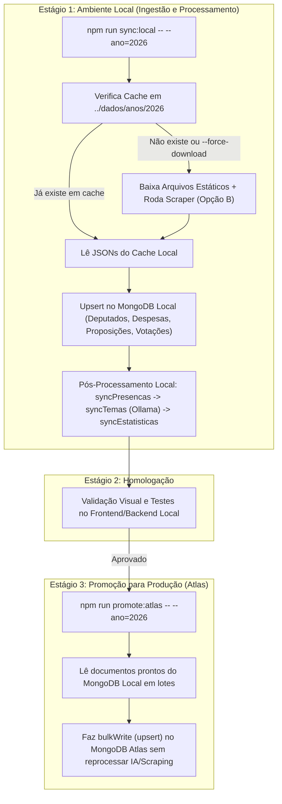

# Plano de Automação e Atualização de Dados (`backend-projeto-depudados`)

## 1. Decisões Arquiteturais Definidas

1. **Abordagem Híbrida + Enriquecimento via Portal (Opção B):**
   - **Arquivos Estáticos da Câmara:** Usados para a carga pesada anual (Despesas, Proposições base, Autores de Proposições, Votações, Votos, Eventos e Presenças).
   - **API REST da Câmara:** Usada para dados cadastrais leves (Partidos e Detalhes dos Deputados como `cpf`, `escolaridade` e `ultimoStatus`).
   - **Web Scraping / Busca do Portal Integrado (Opção B):** Mantido e integrado ao pipeline para enriquecer as proposições com dados exclusivos do portal (`tipoSituacaoProposicao`, `qtdeDeTramitacoes`, `codProposicaoApensadaPai`, `resultadoItens`, `estados`, `temas`), garantindo a precisão do `scoreEficiencia`.
2. **Cache Local em Disco (`../dados`):**
   - Todos os arquivos baixados (ZIP/JSON) e resultados do scraping ficam salvos e organizados na pasta `../dados` por ano/legislatura.
   - Se o arquivo já existir no cache local, o job o reutiliza imediatamente; para forçar um novo download da Câmara, basta passar a flag `--force-download`.
3. **Fluxo de Homologação Seguro (Banco Local -> Validação -> MongoDB Atlas):**
   - Todo o pipeline pesado (downloads, scraping, classificação no Ollama e cálculos de estatísticas) roda **100% no MongoDB Local**.
   - Somente após validar os dados localmente, um comando de promoção (`npm run promote:atlas`) replica os documentos já prontos e validados do banco local para o **MongoDB Atlas**.
4. **Suporte a Múltiplas Legislaturas (Evolução Planejada):**
   - Manter o histórico de múltiplas legislaturas (ex.: 57ª e 58ª) coexistindo no banco de dados sem sobrescrever os dados consolidados da legislatura anterior.

---

## 2. Estrutura do Cache Local (`../dados`)

Para organizar os arquivos baixados automaticamente e evitar downloads repetidos:

```text
projeto-depudados/
 └── dados/
      ├── legislaturas/
      │    └── 57/
      │         ├── deputados-base.json
      │         ├── deputados-detalhados.json
      │         └── partidos.json
      ├── anos/
      │    └── 2026/
      │         ├── despesas.json
      │         ├── proposicoes.json
      │         ├── proposicoesAutores.json
      │         ├── proposicoes-busca.json      # Gerado pelo scraper (Opção B)
      │         ├── votacoes.json
      │         ├── votacoesVotos.json
      │         ├── eventos.json
      │         └── presencas.json
```

---

## 3. Mapeamento das Fontes de Dados e Chaves de Upsert (Idempotência)

Cada etapa utiliza `bulkWrite` com `upsert: true` para permitir reexecuções sem duplicar documentos:

### 3.1. Dados Cadastrais (Por Legislatura)
1. **[`Partido`](file:///c:/Users/olive/Documents/ufc/decimo_primeiro_semestre/piw/projeto-depudados/backend-projeto-depudados/src/models/partido.model.ts)**
   - **Fonte:** `GET https://dadosabertos.camara.leg.br/api/v2/partidos?idLegislatura={leg}&itens=100`
   - **Chave de Upsert:** `{ id: partido.id }`
2. **[`Deputado`](file:///c:/Users/olive/Documents/ufc/decimo_primeiro_semestre/piw/projeto-depudados/backend-projeto-depudados/src/models/deputado.model.ts) (Base + Detalhes)**
   - **Fonte Base:** `https://dadosabertos.camara.leg.br/arquivos/deputados/json/deputados.json` (filtrando deputados da legislatura) + `GET /api/v2/deputados?idLegislatura={leg}`.
   - **Fonte Detalhes (`cpf`, `escolaridade`, `ultimoStatus`):** `GET https://dadosabertos.camara.leg.br/api/v2/deputados/{id}` com concorrência controlada (ex.: lotes de 5 requisições simultâneas) e salvamento em `dados/legislaturas/{leg}/deputados-detalhados.json`.
   - **Chave de Upsert:** `{ _id: deputado.id }`

### 3.2. Dados Transacionais (Por Ano)
1. **[`Despesa`](file:///c:/Users/olive/Documents/ufc/decimo_primeiro_semestre/piw/projeto-depudados/backend-projeto-depudados/src/models/despesa.model.ts)**
   - **URL:** `https://dadosabertos.camara.leg.br/arquivos/despesasCota/json/Ano-{ano}.json.zip`
   - **Normalização:** Garantir preenchimento de `idDeputado` (a partir de `ideCadastro` ou `numeroDeputadoID`) como `Number`.
   - **Estratégia de Atualização:** Como o arquivo anual de despesas tem centenas de milhares de registros e algumas notas não possuem `idDocumento` único (ex.: passagens/telefonia), a abordagem mais rápida e limpa para atualizar um ano no banco local é remover as despesas daquele `{ ano }` (`Despesa.deleteMany({ ano })`) e inserir o arquivo atualizado em lotes de 5.000 via *stream* (`insertMany` ordenado: false).
2. **[`Proposicao`](file:///c:/Users/olive/Documents/ufc/decimo_primeiro_semestre/piw/projeto-depudados/backend-projeto-depudados/src/models/proposicao.model.ts) (Base Oficial + Enriquecimento Opção B)**
   - **Passo 1 (Arquivo Estático Oficial):** `https://dadosabertos.camara.leg.br/arquivos/proposicoes/json/proposicoes-{ano}.json`
   - **Passo 2 (Enriquecimento via Scraper Opção B):** Busca paginada no portal da Câmara filtrando por `{ ano }` (e/ou autores da legislatura), salvando em `dados/anos/{ano}/proposicoes-busca.json` e aplicando a lógica de [`syncProposicoesBusca.ts`](file:///c:/Users/olive/Documents/ufc/decimo_primeiro_semestre/piw/projeto-depudados/backend-projeto-depudados/src/jobs/syncProposicoesBusca.ts) (`$set` apenas nos campos enriquecidos, preservando `temas` já classificados pelo Ollama caso o portal não traga tema).
   - **Chave de Upsert:** `{ _id: prop.id }`
3. **[`ProposicaoAutor`](file:///c:/Users/olive/Documents/ufc/decimo_primeiro_semestre/piw/projeto-depudados/backend-projeto-depudados/src/models/proposicaoAutor.model.ts)**
   - **URL:** `https://dadosabertos.camara.leg.br/arquivos/proposicoesAutores/json/proposicoesAutores-{ano}.json`
   - **Chave de Upsert:** `{ idProposicao: item.idProposicao, idDeputadoAutor: item.idDeputadoAutor, nomeAutor: item.nomeAutor }`
4. **[`Votacao`](file:///c:/Users/olive/Documents/ufc/decimo_primeiro_semestre/piw/projeto-depudados/backend-projeto-depudados/src/models/votacao.model.ts) e [`VotoDeputado`](file:///c:/Users/olive/Documents/ufc/decimo_primeiro_semestre/piw/projeto-depudados/backend-projeto-depudados/src/models/votoDeputado.model.ts)**
   - **URLs:**
     - `https://dadosabertos.camara.leg.br/arquivos/votacoes/json/votacoes-{ano}.json`
     - `https://dadosabertos.camara.leg.br/arquivos/votacoesVotos/json/votacoesVotos-{ano}.json`
   - **Chaves de Upsert:**
     - `Votacao`: `{ _id: votacao.id }`
     - `VotoDeputado`: `{ idVotacao: voto.idVotacao, "deputado_.id": String(voto.deputado_.id) }`
5. **Eventos e Presenças ([`syncPresencas.ts`](file:///c:/Users/olive/Documents/ufc/decimo_primeiro_semestre/piw/projeto-depudados/backend-projeto-depudados/src/jobs/syncPresencas.ts))**
   - **URLs:**
     - `https://dadosabertos.camara.leg.br/arquivos/eventos/json/eventos-{ano}.json`
     - `https://dadosabertos.camara.leg.br/arquivos/eventosPresencaDeputados/json/eventosPresencaDeputados-{ano}.json`

---

## 4. Pipeline em 2 Estágios: Local -> Validação -> Atlas

### Variáveis de Ambiente (`.env`)
```env
# Banco principal de trabalho/validação (Local)
MONGODB_URI=mongodb://127.0.0.1:27017/projeto-deputados

# Banco remoto de produção (usado apenas pelo script de promoção)
MONGODB_URI_ATLAS=mongodb+srv://...
```

### Fluxo Completo



### Como funcionará o `promoteToAtlas.ts` (`npm run promote:atlas`)
Em vez de rodar scraping e Ollama novamente na nuvem, o job de promoção abre duas conexões do Mongoose (`localConn` e `atlasConn`) e sincroniza as collections na ordem:
1. `partidos` (todos)
2. `deputados` (todos — já com `estatisticas`, `resumoGastos`, `resumoProposicoes`, `resumoPresencas` e `temasProposicoes` calculados localmente!)
3. `proposicoes` e `proposicoesAutores` (filtrados pelo `--ano` ou todos)
4. `votacoes` e `votosDeputados` (filtrados pelo `--ano` ou todos)
5. `despesas` (substituição/upsert em lotes do `--ano` atualizado)

---

## 5. Preparação para Múltiplas Legislaturas (57ª, 58ª...)

Atualmente, um deputado que se reeleger na 58ª legislatura terá o mesmo `_id`. Para mantermos as duas legislaturas consultáveis no sistema sem perder a visão de cada mandato:

1. **O que já está pronto por ano:**
   - `resumoGastos` e `resumoProposicoes` dentro de [`Deputado`](file:///c:/Users/olive/Documents/ufc/decimo_primeiro_semestre/piw/projeto-depudados/backend-projeto-depudados/src/models/deputado.model.ts) já são arrays separados por `ano` (`2023..2026` =Legislatura 57; `2027..2030` = Legislatura 58).
   - As collections `Despesa`, `Proposicao`, `Votacao` e `VotoDeputado` possuem datas/anos próprios.
2. **O que precisará ser adicionado no Model [`Deputado`](file:///c:/Users/olive/Documents/ufc/decimo_primeiro_semestre/piw/projeto-depudados/backend-projeto-depudados/src/models/deputado.model.ts) (Fase 2):**
   - Adicionar `legislaturas: [Number]` (ex.: `[57, 58]`) para filtrar rapidamente quais deputados pertencem a qual legislatura na listagem/busca.
   - Adicionar um subdocumento por legislatura (`mandatos` ou `estatisticasPorLegislatura`) contendo `{ idLegislatura, ultimoStatus, estatisticas, resumoPresencas }`, mantendo os campos da raiz apontando para a legislatura mais recente do deputado para não quebrar contratos atuais da API.

---

## 6. Roteiro de Implementação (Passo a Passo)

### Fase 1: Automação de Download, Cache e Ingestão Local
- [ ] **Passo 1.1:** Criar `src/utils/cacheDownloader.util.ts` (funções puras para baixar JSON e descompactar `.zip` da Câmara salvando em `../dados`, respeitando o cache local).
- [ ] **Passo 1.2:** Criar `src/jobs/syncCadastros.ts` (busca Partidos e Deputados base + detalhes via API REST da Câmara, salva no cache e faz upsert no banco).
- [ ] **Passo 1.3:** Criar `src/jobs/syncDadosAnuais.ts` (baixa/lê do cache e faz ingestão em lotes de `Despesa`, `Proposicao`, `ProposicaoAutor`, `Votacao` e `VotoDeputado` para o `--ano` informado).
- [ ] **Passo 1.4:** Integrar o scraper de busca de proposições (`Opção B`) como etapa do pipeline para gerar/atualizar o `proposicoes-busca.json` do ano e rodar o [`syncProposicoesBusca.ts`](file:///c:/Users/olive/Documents/ufc/decimo_primeiro_semestre/piw/projeto-depudados/backend-projeto-depudados/src/jobs/syncProposicoesBusca.ts).
- [ ] **Passo 1.5:** Criar o orquestrador `src/jobs/syncAll.ts` que encadeia: `syncCadastros` -> `syncDadosAnuais` -> `syncProposicoesBusca` -> `syncPresencas` -> `syncTemas` -> `syncEstatisticas`.

### Fase 2: Promoção Local -> Atlas
- [ ] **Passo 2.1:** Criar `src/jobs/promoteToAtlas.ts` para copiar em lotes os dados validados do `MONGODB_URI` (local) para o `MONGODB_URI_ATLAS` (produção).

### Fase 3: Múltiplas Legislaturas
- [ ] **Passo 3.1:** Evoluir o schema de [`Deputado`](file:///c:/Users/olive/Documents/ufc/decimo_primeiro_semestre/piw/projeto-depudados/backend-projeto-depudados/src/models/deputado.model.ts) e os endpoints de listagem/detalhes para aceitar filtro por `idLegislatura` (ex.: `57` ou `58`), isolando o cálculo de `estatisticas` e `resumoPresencas` por legislatura.
